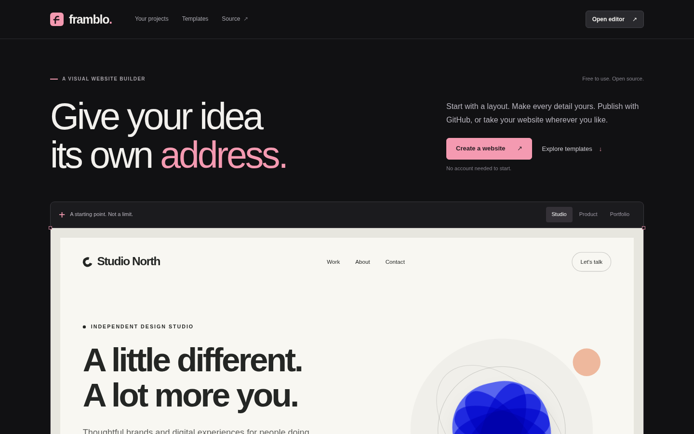

# Framblo

**A free, open source website builder that gives you real code. Design visually, export ordinary HTML, CSS and JavaScript, host it anywhere.**



## Quick start

The fastest way to try Framblo is the hosted app: **[framblo.vercel.app](https://framblo.vercel.app/)**

1. Open the app. No account, no sign up.
2. Pick a template or start blank.
3. Click text to edit it, drag in new sections, change the theme.
4. Export a ZIP of real website files, or connect GitHub and publish in one click.

Your work saves automatically in your browser. Download a project backup (JSON) if you want to move between devices.

## Why Framblo

- **You own the output.** Exports are plain HTML, CSS, JavaScript and images. Nothing depends on Framblo to keep running.
- **Free and open source.** MIT licence, no paid tiers, no locked sections.
- **Local first.** Editing works offline in your browser. Accounts are optional and only used for GitHub publishing.
- **Real publishing.** Connect GitHub once and publish your site to your own repository, ready for GitHub Pages.

## Run it locally

Node.js 20 or later. No packages are needed for the app itself.

```sh
npm run build
python -m http.server 4173 --directory dist
```

Open http://localhost:4173.

## Test

```sh
npm test            # build plus source invariant checks
npm run test:browser  # full editor flow in real Chromium (see below)
```

Browser tests install a pinned Playwright into `.qa/`, separate from the app:

```sh
npm install --prefix .qa --no-audit --no-fund --save-exact playwright@1.63.0
node .qa/node_modules/playwright/cli.js install --with-deps chromium
npm run test:browser
```

## How it fits together

- `src/editor.base.html`: the editor engine, project model, render/export code and storage.
- `ui/home.html`, `ui/framblo.css`, `ui/enhance.js`: the homepage, workspace and design system.
- `scripts/build.mjs`: assembles the self-contained `dist/index.html` that Vercel serves.
- `api/github/` and `lib/github.js`: the GitHub App backend used for one click publishing.

## Maintainer notes

Deployments run on Vercel (`npm run build`, output `dist`, `api/github` as Node.js functions).

### GitHub App setup

Production needs these environment variables: `GITHUB_CLIENT_ID`, `GITHUB_CLIENT_SECRET`, `FRAMBLO_SESSION_SECRET`, `GITHUB_APP_SLUG`, `FRAMBLO_PUBLIC_URL`.

Secrets live only in Vercel's server side variables, never in the repo or browser code. Editing and exporting work with no GitHub configuration at all.

## Licence

[MIT](LICENSE). You are responsible for the content and images in websites you publish.
